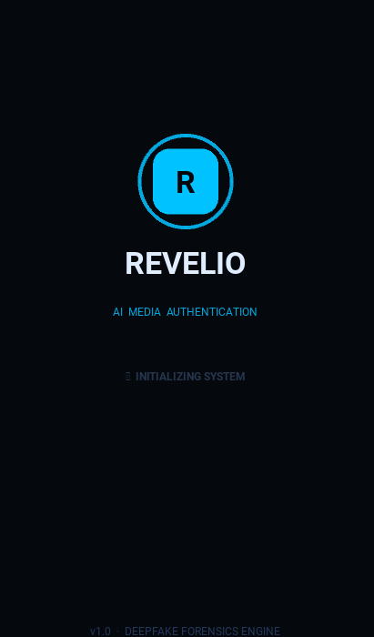
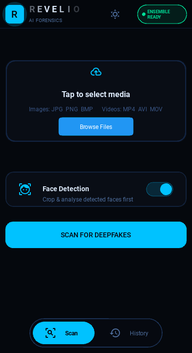
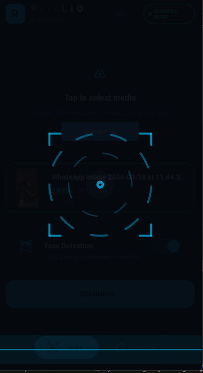
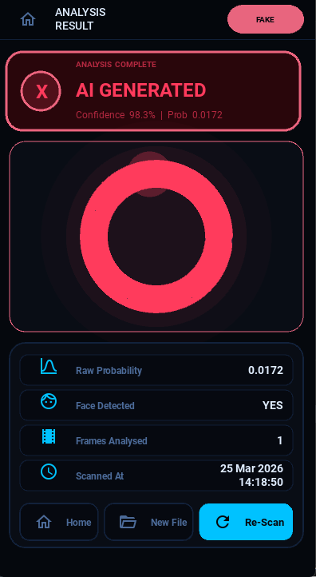
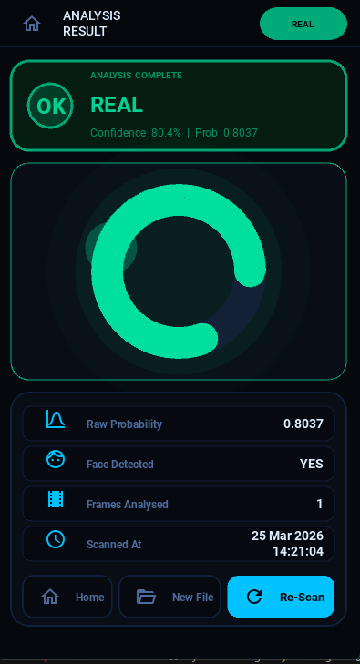
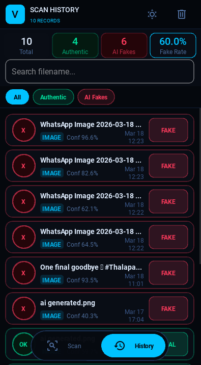

# 🔍 REVELIO
### AI-Powered Deepfake Detection & Media Authentication System

<p align="center">
  **Uncovering Digital Manipulation Through Artificial Intelligence**
</p>

<p align="center">
  A deep learning-powered desktop application that analyzes images and videos to identify potentially manipulated and AI-generated media using computer vision and neural networks.
</p>

---

## 📌 Overview

**REVELIO** is an AI-powered media authentication application developed to identify potentially manipulated images and videos using deep learning and computer vision techniques.

As generative AI technologies continue to advance, distinguishing authentic digital content from AI-generated or manipulated media has become increasingly challenging.

REVELIO addresses this challenge by integrating trained convolutional neural network models, facial analysis, image preprocessing, and video frame analysis into a unified desktop application.

The application provides an interactive environment where users can upload images or videos, perform AI-based analysis, review prediction results, and access previous scans.

**The primary goal is to explore how artificial intelligence can contribute to digital media verification and deepfake detection.**

---

## ✨ Key Features

| Feature | Description |
|---|---|
| 🖼️ Image Detection | Analyzes images to identify potentially manipulated or AI-generated content. |
| 🎬 Video Detection | Analyzes sampled video frames using a dedicated trained model. |
| 🧠 Deep Learning | Integrates trained CNN-based models for media classification. |
| 👤 Face Detection | Detects and processes facial regions during image preprocessing. |
| ⚙️ Image Preprocessing | Performs resizing, normalization, and image preparation. |
| 🔬 Ensemble Image Analysis | Integrates two trained image detection models. |
| 📊 Prediction Results | Displays classification verdicts and confidence information. |
| 🗂️ Scan History | Maintains previous scan records using SQLite. |
| 🖥️ Desktop Interface | Provides an interactive interface built with Kivy and KivyMD. |
| 🔒 Local Inference | Designed for local model inference without requiring a cloud prediction service. |

---

## 🛠️ Technology Stack

| Category | Technologies |
|---|---|
| Programming Language | Python |
| Deep Learning Framework | TensorFlow, Keras |
| CNN Architectures | EfficientNetB0, MobileNetV2 |
| Computer Vision | OpenCV |
| Numerical Processing | NumPy |
| Desktop Application | Kivy, KivyMD |
| Database | SQLite |
| Development Environment | VS Code, Jupyter Notebook |
| Version Control | Git, GitHub |

---

## 🧠 Deep Learning Architecture

REVELIO combines deep learning and computer vision techniques to analyze digital images and videos.

### 1. Image Detection Models

The image detection module integrates two trained image classification models.

**Model architecture:**
- EfficientNetB0-based CNN models
- Transfer learning
- Fine-tuning
- Image preprocessing
- Neural network-based classification

**Trained model files:**

```text
deepfake_efficientnetb0_best1.h5
deepfake_efficientnetb0_final1.h5
```

The models are loaded through the centralized model-loading module and integrated into the image detection pipeline.

### 2. Video Detection Model

Video analysis uses a separate trained deep learning model.

The video detection pipeline extracts selected frames from an input video and processes them for deepfake classification.

**Model file:**

```text
deepfake_video_model_v2.h5
```

The video model is distributed separately because of its large file size.

---

## 📊 Dataset & Model Performance

REVELIO uses a cleaned image dataset containing authentic and fake images for training and validation.

### Dataset Distribution

**Training Dataset**

| Category | Images |
|---|---:|
| Fake | 2,879 |
| Real | 2,916 |
| **Total** | **5,795** |

**Validation Dataset**

| Category | Images |
|---|---:|
| Fake | 616 |
| Real | 625 |
| **Total** | **1,241** |

### Overall Dataset Statistics

| Category | Images |
|---|---:|
| Fake Images | 3,495 |
| Real Images | 3,541 |
| **Total Dataset** | **7,036** |

### Training Configuration

| Parameter | Configuration |
|---|---|
| Training Split | 80% |
| Validation Split | 20% |
| Input Image Size | 224 × 224 |
| Batch Size | 16 |
| Learning Rate (Fine-Tuning) | 0.00001 |
| Training Approach | Transfer Learning & Fine-Tuning |
| Framework | TensorFlow / Keras |

### Model Performance

**Best reported validation accuracy: 92.13%**

The reported validation accuracy represents the project's best fine-tuned model result. It should be interpreted in the context of the specific training run and evaluation dataset.

> Model performance on unseen datasets and real-world deepfakes may differ. Validation accuracy alone does not establish real-world detection reliability.

---

## 🏗️ System Architecture

REVELIO follows a modular application architecture that separates the user interface, detection logic, and utility operations.

```text
                 ┌──────────────────────┐
                 │   REVELIO DESKTOP    │
                 │     APPLICATION     │
                 └──────────┬───────────┘
                            │
                            ▼
                 ┌──────────────────────┐
                 │    Kivy / KivyMD     │
                 │     User Interface  │
                 └──────────┬───────────┘
                            │
                            ▼
                 ┌──────────────────────┐
                 │    Media Selection   │
                 └──────────┬───────────┘
                            │
                   ┌────────┴────────┐
                   │                 │
                   ▼                 ▼
             IMAGE INPUT        VIDEO INPUT
                   │                 │
                   ▼                 ▼
             Face Detection     Frame Extraction
                   │                 │
                   ▼                 ▼
             Preprocessing      Preprocessing
                   │                 │
                   ▼                 ▼
            Image Detection    Video Detection
                   │                 │
                   ▼                 ▼
             Image Models       Video Model
                   │                 │
                   └────────┬────────┘
                            │
                            ▼
                 ┌──────────────────────┐
                 │  Prediction Results  │
                 └──────────┬───────────┘
                            │
                   ┌────────┴────────┐
                   │                 │
                   ▼                 ▼
              Result Screen     SQLite Database
                                     │
                                     ▼
                                Scan History
```

---

## 🔬 Detection Workflow

### 🖼️ Image Detection Pipeline

The image detection pipeline analyzes uploaded images through facial preprocessing and trained neural network models.

```text
       Image Selection
              │
              ▼
       Image Loading
              │
              ▼
        Face Detection
              │
        ┌─────┴─────┐
        │           │
        ▼           ▼
    Face Found   No Face Found
        │           │
        ▼           ▼
    Face Crop    Full Image
        │           │
        └─────┬─────┘
              │
              ▼
       Image Resizing
          224 × 224
              │
              ▼
        Normalization
              │
              ▼
       Trained CNN Models
              │
              ▼
       Prediction Processing
              │
              ▼
       Authenticity Result
```

### 🎬 Video Detection Pipeline

The video detection pipeline uses frame extraction and a dedicated trained model to analyze video content.

```text
        Video Selection
               │
               ▼
        OpenCV VideoCapture
               │
               ▼
        Frame Extraction
               │
               ▼
        Frame Preprocessing
               │
               ▼
        Deep Learning Model
               │
               ▼
        Frame Predictions
               │
               ▼
        Prediction Aggregation
               │
               ▼
        Final Video Result
```

---

## 🖥️ Application Modules

REVELIO is organized into three primary functional modules.

### 1. User Interface Module

Built using Kivy and KivyMD.

| Component | Responsibility |
|---|---|
| Splash Screen | Application initialization and introduction |
| Analyze Screen | Image and video selection and analysis |
| Result Screen | Displays detection results |
| History Screen | Displays previous scans |
| Widgets | Reusable interface components |
| Theme | Application appearance and styling |

### 2. Core Detection Module

Contains the main artificial intelligence and computer vision functionality.

| File | Responsibility |
|---|---|
| `model_loader.py` | Loads trained models and handles model initialization |
| `image_detector.py` | Implements the image detection pipeline |
| `video_detector.py` | Implements video analysis |
| `face_utils.py` | Face detection and facial image preprocessing |

### 3. Utility Module

| File | Responsibility |
|---|---|
| `helpers.py` | Common application helper functions |
| `database.py` | SQLite database operations |

---

## 📁 Project Structure

```text
REVELIO/
│
├── main.py
├── README.md
├── requirements.txt
├── .gitignore
│
├── core/
│   ├── __init__.py
│   ├── model_loader.py
│   ├── face_utils.py
│   ├── image_detector.py
│   └── video_detector.py
│
├── utils/
│   ├── __init__.py
│   ├── helpers.py
│   └── database.py
│
├── ui/
│   ├── __init__.py
│   ├── app.py
│   ├── widgets.py
│   ├── theme.py
│   │
│   └── screens/
│       ├── __init__.py
│       ├── splash_screen.py
│       ├── analyze_screen.py
│       ├── result_screen.py
│       └── history_screen.py
│
├── models/
│   └── README.md
│
└── assets/
    └── screenshots/
```

---

## ⚙️ Installation & Setup

### Prerequisites

- Python 3.10 recommended
- pip package manager
- Windows or another supported desktop operating system
- Sufficient RAM and storage for deep learning inference

### Step 1: Clone the Repository

```bash
git clone https://github.com/refaisahamed0310-pixel/Revelio-deepfake-detection.git
```

### Step 2: Navigate to the Project Directory

```bash
cd Revelio-deepfake-detection
```

### Step 3: Create a Virtual Environment

```bash
python -m venv venv
```

### Step 4: Activate the Environment

**Windows:**

```bash
venv\Scripts\activate
```

### Step 5: Install Dependencies

```bash
pip install -r requirements.txt
```

### Step 6: Configure the Trained Models

Place the required trained model files in the project root directory.

```text
REVELIO/
│
├── deepfake_efficientnetb0_best1.h5
├── deepfake_efficientnetb0_final1.h5
└── deepfake_video_model_v2.h5
```

The large video model is distributed separately and must be obtained before running the complete video detection pipeline.

Refer to the model documentation for model download and setup instructions.

### Step 7: Launch REVELIO

```bash
python main.py
```

---

## 📸 Application Screenshots

Actual application screenshots will be added to showcase the REVELIO interface and its main functionalities.

| Application Screen | Description |
|---|---|
| Splash Screen | Application introduction  
| Home | Application introduction  
| Image and Video Analysis | Image and Video analysis 
| Detection Results - AI | Prediction and confidence display 
| Detection Results - REAL | Prediction and confidence display 
| Scan History | Previous analysis records 

**Screenshots directory:**

```text
assets/screenshots/
```

---

## ⚠️ Limitations

- Detection accuracy depends on the quality and diversity of training data.
- Previously unseen deepfake generation techniques may affect model reliability.
- Face detection may be affected by lighting, facial angles, and occlusion.
- Video analysis depends on frame sampling and video quality.
- AI predictions should not be treated as definitive proof of media authenticity.

---

## 🔮 Future Enhancements

- Android application integration.
- Improved facial detection and tracking.
- Expanded and more diverse training datasets.
- Enhanced detection against emerging deepfake generation techniques.
- Optimized inference for systems with limited hardware resources.
- More comprehensive video frame-level analysis.
- Improved visualization and reporting of detection results.

---

## 🎯 Project Objective

The primary objective of REVELIO is to explore the practical application of artificial intelligence, deep learning, and computer vision in digital media authentication.

By integrating trained neural network models with an interactive desktop application, the project demonstrates an end-to-end approach to detecting potentially manipulated images and videos.

---

## 👨‍💻 Developer

**Ahamed Refai S**

B.Sc. Computer Science | AI & Machine Learning Enthusiast

Interested in Artificial Intelligence, Machine Learning, Deep Learning, and Python Development.

- **GitHub:** [refaisahamed0310-pixel](https://github.com/refaisahamed0310-pixel)
- **LinkedIn:** [Ahamed Refai](https://www.linkedin.com/in/ahamed-refai-s-6775b2310/)

---

<p align="center">
  **REVELIO**
  
  *Exploring AI for a More Trustworthy Digital World.*
</p>
